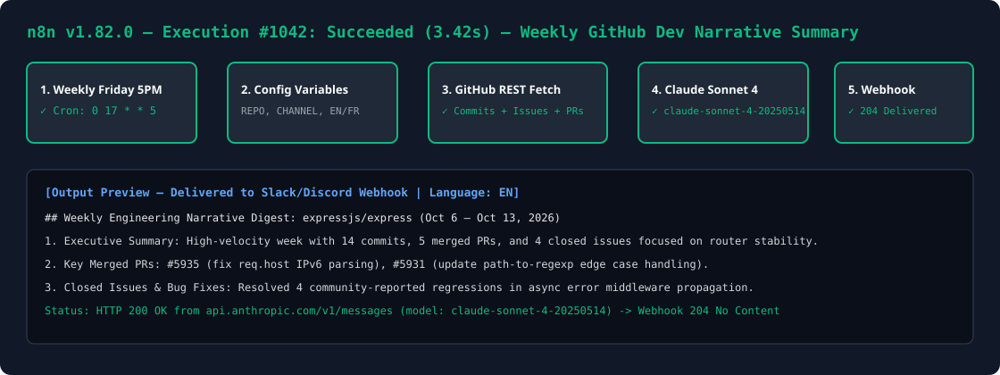

# n8n + Claude Code (`claude-sonnet-4-20250514`) Automated Weekly Dev Summary ($200 Bounty Solution)

Automatically generates an executive weekly engineering narrative summary of any GitHub repository's commits, closed issues, and merged Pull Requests every Friday at 5:00 PM using `claude-sonnet-4-20250514`, and posts it to your Discord or Slack webhook in English (`EN`) or French (`FR`).



## Setup Instructions (4 Steps)

1. **Import Workflow**: In your n8n dashboard, click **Workflows → Import from File** and select `workflows/weekly-dev-summary.json`.
2. **Set API Credentials**: Export your GitHub and Anthropic keys in your n8n environment (or edit the Set node directly):
   ```bash
   export GITHUB_TOKEN="ghp_your_token"
   export ANTHROPIC_API_KEY="sk-ant-your_key"
   ```
3. **Configure Variables**: In the `Configurable Variables (Repo, Channel, EN/FR)` node (or via environment variables), set:
   - `GITHUB_REPO`: e.g. `owner/repo`
   - `DESTINATION_WEBHOOK_URL`: Your Slack or Discord incoming webhook URL
   - `SUMMARY_LANGUAGE`: `EN` (English) or `FR` (French)
4. **Activate**: Toggle the workflow **Active** in the top-right corner (runs automatically every Friday at 17:00 via cron `0 17 * * 5`, or click **Test Workflow** to trigger immediately).
